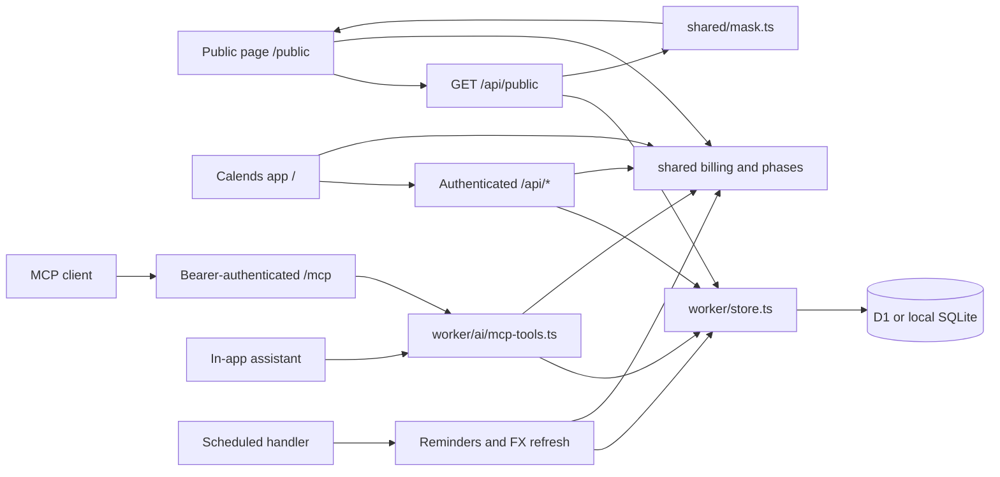

# Architecture

[README](README.md) · [Contributing](CONTRIBUTING.md) · [Code standards](docs/code-standards.md) · [Self-hosting](docs/self-hosting.md)

Calends is a single-owner ledger with two web entry points and one Worker backend. React renders the interface; shared TypeScript calculates billing and financial metrics; D1 provides the persistence API. Docker runs the same Worker locally with SQLite, rather than a separate server implementation.

## Runtime map

Arrows show calls or response flow, not separate services. The public API checks whether sharing is enabled before returning masked state. Browser sessions and MCP bearer tokens are independent authentication mechanisms. A configured `BASE_PATH` prefixes these routes; examples below assume a root deployment.

## Subsystems and source of truth

| Subsystem                         | Start here                                                                                                                                             | Responsibilities                                                                |
| --------------------------------- | ------------------------------------------------------------------------------------------------------------------------------------------------------ | ------------------------------------------------------------------------------- |
| App entry and navigation          | [app/src/main.tsx](app/src/main.tsx), [app/src/app.tsx](app/src/app.tsx), [app/src/router.ts](app/src/router.ts)                                       | Choose the app or public entry, load the relevant UI and handle app routes.     |
| Browser state and persistence     | [app/src/store.ts](app/src/store.ts), [worker/index.ts](worker/index.ts), [worker/store.ts](worker/store.ts)                                           | API requests, optimistic updates, state loading and database writes.            |
| Billing and subscription history  | [shared/types.ts](shared/types.ts), [shared/billing.ts](shared/billing.ts), [shared/phases.ts](shared/phases.ts)                                       | Data shapes, charges, cycles, trials, price changes and plan periods.           |
| Financial views                   | [shared/metrics.ts](shared/metrics.ts), [shared/fx.ts](shared/fx.ts), [app/src/derive.ts](app/src/derive.ts)                                           | Metrics, currency conversion and derived presentation data.                     |
| Sharing and access                | [shared/mask.ts](shared/mask.ts), [worker/auth.ts](worker/auth.ts), [worker/ics.ts](worker/ics.ts)                                                     | Public allow-listing, passwords, passkeys, sessions and private calendar feeds. |
| AI tools and assistant            | [worker/ai/](worker/ai/README.md): `mcp.ts`, `mcp-tools.ts`, `assistant.ts`                                                                            | MCP transport, token scopes, domain tools and assistant draft/apply flow.       |
| Scheduling and delivery           | [worker/notify.ts](worker/notify.ts), [worker/channels.ts](worker/channels.ts), [worker/fx.ts](worker/fx.ts)                                           | Renewal/digest scheduling, channel delivery and exchange-rate history.          |
| Storage evolution and portability | [worker/migrations/](worker/migrations/), [worker/migrate.ts](worker/migrate.ts), [worker/backup.ts](worker/backup.ts), [shared/csv.ts](shared/csv.ts) | Schema migration, JSON backup compatibility and CSV conversion.                 |

Read the linked implementation and its callers before changing a subsystem. This document records current contracts; proposed architecture belongs in an issue or PR until implemented.

## Web requests and state

`app/src/main.tsx` loads the public entry for `/public` and `app/src/app.tsx` for application pages and `/login`. These bundles have separate component and style trees. The app uses shared components in `app/src/components/`; the public page uses `app/src/public/`.

Application routes are `/overview` (overview), `/list`, `/calendar`, `/report`, `/wallet`, `/family`, `/family/people`, `/behalf`, `/assistant`, `/connect` (AI access), `/settings` and `/cat/<category>`. Unauthenticated visits to application pages redirect to `/login?next=<route>`, with the original app route URL-encoded in `next`; successful login returns to that page. For example, `/wallet` redirects to `/login?next=wallet`. An unauthenticated visit to `/` goes to `/public` when public sharing is enabled in Settings, otherwise to `/login`. The read-only `/public` page is available only when public sharing is enabled. An authenticated visit to `/` redirects to the configured start page, defaulting to `/overview` when none is set or the configured page is unavailable.

The app boots through `boot()` in `app/src/store.ts`, showing cached state when available and then requesting `/api/state`. Authenticated state contains subscriptions, payment methods, settings, people, preferences and current/historical FX. Unauthorized responses return the browser to login and remove the private cache. Optimistic writes use the same store and reconcile against server results; browser cache is not the durable ledger.

`Settings.signedAmounts` defaults to enabled when absent. The app root applies it through `setSignedAmounts()` in [shared/format.ts](shared/format.ts) and remounts the app when it changes, as for locale changes. `flow()` formats directed cash flows (negative outflows, positive inflows); prices, balances and comparisons retain their own formatting. This display-only setting uses the existing settings JSON persistence and does not change amounts. `maskForPublic()` allow-lists the flag (default enabled), and public timeline cash flows use the same `flow()` convention as the app.

Ledger changes advance a monotonic `kv.rev` through database triggers in [0007_state_rev.sql](worker/migrations/0007_state_rev.sql), inside the same transaction as each write. Subscriptions, methods, dated FX and the `settings`, `people`, `prefs` and current `fx` keys participate, including imports, restores, MCP/assistant actions and scheduled FX writes. Authentication, token/config bookkeeping, notification logs and chat history do not change this revision because they are outside `/api/state`. Authenticated `GET /api/rev` reads only the revision; it and `/api/state` return `Cache-Control: no-store`. The public response omits the revision, and the service worker never caches `/api/rev`.

[Browser sync](shared/live-sync.ts) checks the revision every 30 seconds while visible, and immediately on focus, becoming visible or returning online (with a one-second throttle). Hidden tabs stop polling. A changed revision fetches a transactional state snapshot; successful local writes acknowledge their exact revision range so they do not cause an unnecessary full reload or hide intervening remote changes. A `BroadcastChannel` scoped to `BASE_PATH` announces successful writes to other tabs, which check immediately; polling remains the fallback. In-flight or overlapping local writes prevent stale snapshots from replacing local state. Recent preference edits have a five-second grace period, unsent preference keys remain protected, and remote preferences are mirrored into the local cache. Sync updates the store while open editors retain their own drafts. Offline checks fail quietly; 401 responses clear private state and return to login. This single-owner ledger uses polling rather than WebSockets or CRDTs: it needs neither new server-push infrastructure nor collaborative conflict merging.

Subscription filters in `List.tsx` default to all statuses, the current category route (or all categories), all payment methods and an empty search; Clear restores those values.

Horizontal-dominant wheel events inside the subscription timeline are always consumed, including the all-history range and before width measurement; vertical-dominant events remain available for page scrolling. The container contains horizontal overscroll and allows vertical touch scrolling.

The subscription timeline in `app/src/views/Gantt.tsx` measures visible subscription names with the current font and label padding. `ganttLabelBounds()` in `shared/gantt.ts` limits the name column between its icon-only width and the longest name, capped at half the container width. Filtering, locale, font loading and container resizing refresh that measurement. Desktop and narrow-screen width preferences remain separate; rendering clamps saved widths without rewriting them. Narrow portrait screens show only named icons and suspend resizing, preserving the preference for landscape.

The main report page places the spending composition chart before the stops/losses section. The report footer in `app/src/views/Report.tsx` uses a stretched two-column row above 680px. Its top-up card determines the height, with a 300px minimum when content is short. Size containment keeps the collapsed changelog from growing the row; a resize observer measures entry and year-heading heights to show only complete entries within the available space. The existing More action adds twelve entries and releases containment so the cards can grow. At 680px and below, both cards have natural heights and the log starts with eight entries. Disclosure is local component state and does not change the ledger or saved preferences.

Subscription details in [Detail.tsx](app/src/views/Detail.tsx) show charges from the current year by default, falling back to the most recent year with records. The heading always counts the complete history; multi-year histories offer a reversible local disclosure. [detailForecast()](app/src/views/detail-data.ts) retains the twelve-month forecast for frequent billing and shows only the next charge for cycles of at least a year or at most two charges in that window, searching beyond a year for longer cycles. The next-charge block owns its date and, in compact mode, its price instead of repeating them in the summary, event timeline or header. Lifetime purchases have no renewal forecast. Shared-plan cards and details use [ShareAvatars](app/src/components/ShareAvatars.tsx) for the owner image, member initials, dues colors and overflow count; details only adjust size and overlap. These disclosures and presentation choices do not change stored ledger data.

`worker/index.ts` dispatches APIs, MCP, private ICS feeds and static assets. It runs schema setup before database-backed requests. App writes go through validation and session checks; a public visitor uses `/api/public`, whose response passes through `maskForPublic`. Public privacy therefore belongs at the response boundary, not only in React. `usePref()` subscribes to preference-value snapshots, including the local copy when no authenticated state is loaded, so public theme changes apply immediately.

## Billing and historical truth

`Subscription` in `shared/types.ts` is the shared model. Charges and forecasts are derived by `shared/billing.ts`; `shared/phases.ts` supplies pure history-editing functions. Components and endpoints should call this logic rather than maintaining their own billing formulas.

A subscription may have multiple plan phases, including overlaps and gaps. Each phase can carry its own currency, price, cycle, payment method and adjustments. History-editing functions mirror the last phase into top-level fields for callers that use the current plan; the full phase history remains authoritative for past periods. Price changes and actual payment overrides are distinct inputs to charge calculation. Ending a subscription early is recorded as a `stop` on the current phase (voluntary cancellation or provider termination) together with ordinary refund payments; `stopSummary()` derives the paid-through date, refund status and unused value that the timeline, reports and MCP tools display.

`stopLosses()` in `shared/metrics.ts` aggregates unrefunded unused service per stopped phase, excluding proxy payments and applying my share and stop-date FX. It uses `stopSummary()` with refunds known as of the report date; prorated full refunds have zero loss. The report and MCP `get_insights` (`stop_losses`) expose all history, while `yearReview().stopLoss` filters by stop date in the selected year. Prepaid unused totals and health-check reminders reuse this calculation; losses are separate from the hypothetical renewals avoided in `cancelSavings()`. If both dated and current FX are unavailable, loss rows retain original amounts and mark the aggregate incomplete (`NaN` internally, `null` in MCP base amounts/totals), rather than reporting zero.

Current FX and dated FX history have separate roles. `shared/fx.ts` resolves historical conversion for past charges and current conversion for forecasts. `worker/fx.ts` loads and backfills dated rates; `worker/index.ts` refreshes the current table. `rateOn()` can use a nearby historical date, and `convertOn()` falls back to current rates when history is unavailable. If conversion still fails, `toBaseAt()` currently returns zero. A calculated value therefore does not prove that the exact rate was fetched, or that missing FX represents a real zero expense; account for these existing fallback paths when changing financial displays.

People, family-plan membership and payments on behalf of others reference one ledger. Changes to identity or payment allocation must keep references coherent through [shared/people.ts](shared/people.ts), [shared/carpool.ts](shared/carpool.ts) and [shared/proxy.ts](shared/proxy.ts).

Owner-organized sharing uses `collectionAnchor()` / `collectionPeriod()` / `memberCollection()` in [shared/billing.ts](shared/billing.ts) for dues, reminders and receipt defaults in the member editor and MCP. Optional `Share.collectFrom` overrides the anchor; otherwise it is inferred from `since`, the earliest recorded coverage start (or a period inferred from paid-through when coverage starts are absent), then subscription start. Periods add each member's billing months directly to the original anchor, preserving month-end alignment. Mid-period joins cover the join date through the aligned end inclusive; optional `ShareMember.firstPeriod` is `prorate` (default, actual days / full period days rounded to cents), `full` or `free`, with optional `firstAmount` in the fee currency overriding a non-free partial fee. An exit within that first period clips coverage to the day before exit; later periods retain the regular fee. Free partial periods are skipped without requiring a zero receipt. Saved coverage and actual receipt amounts remain authoritative; missing fields need no migration, JSON persistence and backups retain them. The member editor and MCP member/receipt writes pin the previously inferred anchor to prevent a first receipt from changing it. The member editor refreshes receipt coverage when billing changes while preserving the draft's received date and note. Amount and currency follow defaults until either is manually edited, then both are retained for that draft. Collection dates (`MemberDue.dueFor`) refer to the member's earliest unpaid coverage start, independently of the provider's next charge.

### Scope reports

[shared/scope-report.ts](shared/scope-report.ts) exposes pure `scopeReport(state, subs, today)` and `monthReport(state, month, today)` builders. Both exclude proxy subscriptions and return the same discriminated block union in a fixed order: headline, trend, composition, top, upcoming, events, losses, sharing. Only the headline is mandatory; other blocks and optional facts appear when they have content. [ScopeReport](app/src/components/ScopeReport.tsx) renders either result with the existing report cards and charts, caller-owned title/disclosure state and subscription-detail callbacks. `List.tsx` offers an on-demand scope report below nonempty filtered/search results in grid, list and timeline views, using the existing dirty-filter predicate. It passes all matching non-proxy subscriptions to `scopeReport()` regardless of sorting or the timeline window. The server-synced `list-report` preference stores JSON `{ key, open }`; the key canonically identifies the category route, status, category, payment method and normalized search words. A matching key restores the report and disclosure without assembly animation; a different key offers generation. Only explicit generation animates assembly. Generation uses a focusable dashed title line; after generation it carries only the report title, with copy/collapse controls inside the headline card. Collapsed reports offer expansion on the entire title line, including the report name. While open, the report owns the selected scope totals and the list toolbar omits its duplicate summary. Cards sit directly below the line without an enclosing visual card; explanatory copy uses title hints. The calendar month view defaults to today's selection and a mini report above the monthly charge list. The mini report reads the same headline and six-month net-cash series returned by `monthReport()`, ending at the viewed month, with pending cash drawn with dashed bars. Its expand action shows the full report below the calendar and hides the mini card; a nonempty selected day keeps the same day-detail rows above the report divider and scrolls into view when needed, respecting reduced motion. Empty days have no detail block in either mode; deselected days only show the mini-mode selection prompt. The report omits charge and refund rows owned by that selected day, while retaining complete monthly aggregates and all rows in copied PNGs. Collapsing returns to the mini card and ordinary day details and persists `mini`. Calendar full reports have no collapsed title-line state; list scope-report disclosure is unchanged. The synchronized `cal-report-mode` preference stores `mini | full` (default `mini`); the old `cal-report-open` preference is retained but no longer controls this layout. Day selection toggles off on a second click, clears on month navigation, and returns to today with the Today action or T, independently of the red today marker. Charged-day cards show charge-phase payment methods, cycles and coverage dates, current status, future next-charge dates or known stop/pause/end dates, original/base amounts and refund/loss markers; a distinct same-currency settlement remains visible alongside its original bill amount, while equal formatted amounts appear once. The monthly list keeps its heading inside the charge card so the first right-hand card aligns with the calendar in mini and full modes, without repeating the report total. Its rows follow the sidebar currency preference through `useMoneyPair`, with the secondary currency available as a tooltip. Rows group chronologically beneath a day circle and horizontal rule; only today has a red circle, independently of a light selected-group background. Selection scrolls the list internally when needed. Calendar grid totals and report aggregates use the selected base currency even in original-currency mode. Cash-flow amounts use `Amount` for positive green income and neutral expenses; fractional digits inherit the amount color with reduced opacity. Reports animate on entry and month changes. The year view has neither a mini card nor a scope report.

[ScopeReport](app/src/components/ScopeReport.tsx) offers copying the full report as a PNG when `ClipboardItem` is available, including on narrow screens. It temporarily renders all blocks without assembly animation, then restores the caller-owned disclosure state without persisting a preference change. The shared [snapshot()](app/src/snapshot.ts) renderer preserves fonts and chart styles; clone-only style and size options add the page background, padding and rounded transparent corners without changing the visible page. Its filter excludes the headline action buttons. Mini expansion and report copy/collapse actions reuse the same circular icon-button style and responsive size. Subscription rows reuse 24px `SubIcon` marks and open details from the whole row; composition reuses `MethodMark` and `CatIcon`, with category colors shared by icons and bars. Subscription and custom payment-method images use the same-origin image proxy for PNG export. Monthly movement rows also own their matching event types and stop reasons; remaining events stay in that movement card, so no separate event card repeats them. Scope reports retain their unique event history. Event history, losses and refunds span the full report width. Payment methods without a logo use the same plain mark layout as categories, with the existing wallet glyph. Composition shares one full-width card with category and payment-method columns, stacked on narrow screens. Each dimension is capped in shared code at six rows: five leaders plus an explicit Other row when needed, preserving the amount and share totals. Top and upcoming cards share a stretched two-column row on desktop and stack on narrow screens; upcoming shows at most five rows after excluding monthly top-card duplicates. Monthly movement rows use two columns on desktop and show kind, unsigned before/after monthly costs at period-end FX and the contributing event date or date span (the reporting window when no event is recorded). Their difference is already owned by the driver summary, so rows do not repeat it. The full monthly report uses a minimize action labeled as returning to the summary. Ranking titles interpolate the actual displayed row count in every locale. Clipboard writes use a promised PNG in the click handler for Safari compatibility, and the existing toast flow reports success or failure.

Scope MRR and top monthly costs use `mrrOn()`/`contributionOn()`, billing counts use `totals()`, and the comparison uses `mrrChangeSinceLastMonth()`. Overview and the report movement card share `monthMovement()`: the previous month-end uses dated FX, today uses current FX, and the total difference includes FX effects. Its cash chart uses `cashVsAccrual()` for twelve months including the current month plus three future months; the current month includes remaining scheduled charges, just as the report page does. Year-to-date cash runs from January 1 through today; its loss fact uses stops dated in that year. Events cover the rolling past twelve months through the next thirty days; upcoming charges run from tomorrow through day thirty. Scope losses/refunds cover all history through today.

Monthly cash is the full calendar month's net cash, including refunds and scheduled future charges, with the same my-share and `chargeValue()` settlement/FX basis as `cashVsAccrual()`. Today counts as charged; later dates count as pending. Comparisons use full prior months, omit percentages for nonpositive comparison cash, and omit year-over-year comparison when there were no nonfailed charges in that month. Counts exclude refunds and failed payments. Monthly composition and top charges use positive debits; scope composition uses current MRR, including each active phase's payment method. The monthly `movement()` block ends at today for the current month and month-end for past months, using the report page's FX arguments; future months have no movement block. Monthly upcoming charges are the remaining positive debits after today.

Both event lists reuse `events()` and add recorded trial-end dates, preserving original subscription references for detail navigation. Nonrenewal, immediate cancellation and provider termination remain distinguishable. Losses reuse `stopLosses()` (monthly filtering by stop date, evaluated with refunds known today); refund rows independently use `chargesBetween()` by refund date so full refunds and refunds after the stop month are retained. Missing loss FX remains incomplete with original-currency details. Other cash and MRR values retain the existing FX fallback behavior described above.

The calendar mini and full layouts are mutually exclusive, so only one monthly headline appears. Presentation suppresses repeated single-driver movement deltas, per-item deltas already owned by the movement drivers and matching monthly event deltas, singleton scope rankings that repeat the headline, upcoming monthly charge rows already present in the top-charge card, and singleton loss/refund/sharing subtotals already present in their detail rows. The underlying report data remains complete. The main report page owns its monthly spending delta in the movement card and its historical loss totals in the stops card; other cards do not repeat those headline figures. Subscription details keep refund amounts in charge records (aggregating multiple refunds in the outcome card) and losses in the outcome card, with amount-free event markers. A singleton charge also owns its amount instead of repeating an identical cumulative-spend KPI. Public subscription lists reuse the hero total and category-control counts, omit duplicate same-currency monthly prices in ordinary rows, and identify trials, pauses and nonrenewal when the current contribution differs from the plan price. Member editors distinguish an unset coverage date from no receipt records and omit a duplicate one-receipt subtotal in the same currency.

The overview timeline's past thirty-day cash window includes today; upcoming charges run from tomorrow through day thirty and include only positive, nonfailed debits. This matches the month report's today-is-charged boundary. User-facing next-charge dates and the sidebar likewise start tomorrow; the underlying billing helper and reminder scheduling retain their inclusive-date contract. Overview cash charts and charge lists show full cash paid, including advances for members, with a title hint; subscription MRR and scope/month reports use my share. These are distinct measures, rather than alternative totals for the same period.

Sharing includes only owner-organized plans. Receipts use member payment dates and dated FX; pending collections use the difference between `memberDues()` at the window's end and immediately before its start, excluding older arrears. The window is year-to-date for scopes, the selected month through today for the current month, and the full selected month for past/future months (future dues are forecasts). Directed amounts use `flow()`; spending comparisons use unsigned amounts with increase/decrease arrows independently of the signed-amounts setting. The shared `BarLine` chart places negative net-cash months below its zero baseline.

Reminder preview groups today's candidates and sends separately from recent history. Send dates and times use the owner's configured timezone; previous days never appear under Today.

## Persistence and migration

`worker/store.ts` is the persistence layer. The database stores:

| Storage                                                     | Contents                                                                                                                        |
| ----------------------------------------------------------- | ------------------------------------------------------------------------------------------------------------------------------- |
| `subscriptions`, `methods`                                  | JSON records keyed by ID, plus update timestamps.                                                                               |
| `kv`                                                        | Settings, the people roster, preferences, current FX and credential/configuration records. This SQL table is not Cloudflare KV. |
| `fx_daily`                                                  | Exchange rates and source by date.                                                                                              |
| `sessions`, `passkeys`, `auth_challenges`, `login_attempts` | Authentication and device state.                                                                                                |
| `notify_log`                                                | Delivery records with deduplication keys.                                                                                       |
| `chats`                                                     | Stored assistant conversations.                                                                                                 |

SQL files in `worker/migrations/` define schema history. `scripts/migrations.mjs` generates `worker/migrations.gen.ts` during `npm run build`; `ensureMigrated()` applies missing migrations and records them in `d1_migrations`. The generator uses Wrangler's SQLite-aware statement splitter so multiline trigger bodies stay intact. Wrangler's migration command uses the same tracking table. Add migrations rather than editing already-applied ones.

Backup versioning and compatibility live in `worker/backup.ts`. Exports include subscriptions, methods, people, settings and FX history; they do not recreate login sessions, MCP access tokens or delivery logs on a new installation. Settings may contain notification and other credentials, so backup files are sensitive. A JSON export is not a copy of the whole SQLite database. CSV is a narrower interchange format.

## Authentication, public data and AI

`worker/auth.ts` owns password setup, salted password hashes, passkey challenges, session cookies and device revocation. `SETUP_TOKEN` protects the first owner-password setup. Login offers cancellable WebAuthn conditional autofill alongside password and explicit passkey login, using independent five-minute challenges; expired autofill challenges are retried silently. New passkeys use `owner@<hostname>` as the form account identifier and a display name combining the configured name (or Calends) with the hostname; existing credentials remain valid. Authenticated browser APIs use sessions; an ICS URL contains its own private feed token.

`worker/ai/mcp.ts` provides stateless Streamable HTTP at `/mcp`, using JSON-RPC responses rather than a persistent server-push stream. `/mcp` is a service endpoint; opening it in a browser redirects to the app's AI access page at `/connect`. Only token hashes are stored. Read tokens cannot call write tools; the AI-access setting can disable the endpoint.

Tool behavior lives in `worker/ai/mcp-tools.ts` and is reused by the in-app assistant. Write tools support `dry_run`, which previews the proposed ledger change without saving it. External MCP clients may execute writes with a write-scoped token; confirmation is their responsibility. The normal in-app assistant forces write calls into proposals, then invokes the tool again after confirmation through its apply endpoint. Do not conflate those two flows.

The existing sharing tools expose the same aligned collection rules: `set_share` accepts optional `collect_from` and returns the effective anchor; `save_share_member` accepts optional `joined`, `first_period` and `first_amount`, returning a member summary with inclusive `first_collection` coverage and fee, the anchor, paid-through and next collection date in previews and saves. `record_receivable` defaults omitted share coverage and amount to the next unpaid collection (skipping a free partial first period), while explicit amounts remain actual receipts and mark the selected coverage paid without tracking a residual balance. Explicit amounts retain the collection-currency default; inferred amounts use the fee currency, or receipt-date FX when another currency is requested. The response includes the receipt and updated member summary. Proxy receipts still require an explicit amount. `get_carpool` exposes the overall and per-member anchor, billing months, paid-through, `next_collection_date` (earliest unpaid coverage start, possibly overdue), `pending_amount` (total due as of today, including arrears, zero if none) and `is_first_period` (whether the next unpaid coverage is in the first period). The assistant uses these results for collection dates and dues instead of calculating them itself. Optional inputs preserve old stored records and callers; these remain the same tools with unchanged write permissions and preview behavior.

## Deployment and background work

Personal deployment files use `CALENDS_LOCAL` (absolute or relative to the repository root, default `local/`), resolved by [scripts/local-config.mjs](scripts/local-config.mjs). [scripts/wrangler.mjs](scripts/wrangler.mjs) automatically selects its `wrangler.jsonc` when present unless `--config`/`-c` is explicit; local commands default to `<repo>/.wrangler/state` independently of that directory. [app/vite.config.ts](app/vite.config.ts) serves its `public/` overrides in development and copies them into `dist` during builds. See [self-hosting](docs/self-hosting.md#personal-cloudflare-configuration) for external configuration paths and commands.

Cloudflare runs the Worker with D1, bundled static assets and Cron Triggers. [docker/Dockerfile](docker/Dockerfile) builds those assets, then packages the Worker and its runtime dependencies. [docker/entrypoint.mjs](docker/entrypoint.mjs) migrates local SQLite, prepares the setup token and starts `wrangler dev --local`, which runs workerd. It invokes the local scheduled endpoint every 15 minutes, matching the Cloudflare cron, because local mode does not run cron automatically. Docker does not require a Cloudflare account for this local runtime.

Both targets use the scheduled handler in `worker/index.ts`: every run checks reminders against each owner's local send time and retries failed deliveries; the run at the top of each UTC hour also handles FX maintenance. Delivery deduplication and retry decisions belong to `worker/notify.ts`, not a browser timer. Email binding availability differs by deployment; see the configuration table in the self-hosting guide.

Persist Docker's entire `/data` directory in a volume. It contains local runtime database state and the generated setup-token file; do not assume the database is a single file directly named `/data/calends.sqlite`. Building an image does not publish it. Registry destinations, tags and supported build platforms are configured by [.github/workflows/docker.yml](.github/workflows/docker.yml), while actual publication must be verified against the registry.

## Making a change

Use the [code standards](docs/code-standards.md#verification) for verification and PR evidence. Existing domain tests run with `npm test`; they are not a browser or Worker integration suite. Local development uses Vite on port 5173 and a Worker on port 8787, with API proxying defined in [app/vite.config.ts](app/vite.config.ts).

When a documented contract changes, update the owning section here alongside implementation and tests. Link source files and named functions instead of copying changing implementation details. Keep proposals separate from current behavior and state what has actually been exercised.
