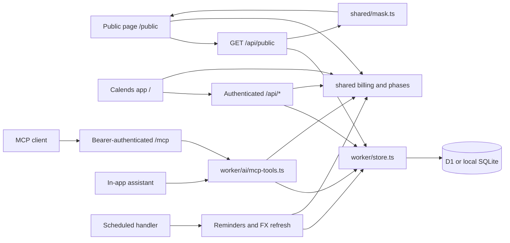

# Architecture

[README](README.md) · [Contributing](CONTRIBUTING.md) · [Code standards](docs/code-standards.md) · [Self-hosting](docs/self-hosting.md)

Calends is a single-owner ledger with two web entry points and one Worker backend. React renders the interface; shared TypeScript calculates billing and financial metrics; D1 provides the persistence API. Docker runs the same Worker locally with SQLite, rather than a separate server implementation.

## Runtime map

Arrows show calls or response flow, not separate services. The public API checks whether sharing is enabled before returning masked state. Browser sessions and MCP bearer tokens are independent authentication mechanisms. A configured `BASE_PATH` prefixes these routes; examples below assume a root deployment.

## Subsystems and source of truth

| Subsystem                         | Start here                                                                                                                                             | Responsibilities                                                                |
| --------------------------------- | ------------------------------------------------------------------------------------------------------------------------------------------------------ | ------------------------------------------------------------------------------- |
| App entry and navigation          | [app/src/main.tsx](app/src/main.tsx), [app/src/app.tsx](app/src/app.tsx), [app/src/router.ts](app/src/router.ts)                                       | Choose the app or public entry, load the relevant UI and handle app routes.     |
| Browser state and persistence     | [app/src/store.ts](app/src/store.ts), [worker/index.ts](worker/index.ts), [worker/store.ts](worker/store.ts)                                           | API requests, optimistic updates, state loading and database writes.            |
| Billing and subscription history  | [shared/types.ts](shared/types.ts), [shared/billing.ts](shared/billing.ts), [shared/phases.ts](shared/phases.ts)                                       | Data shapes, charges, cycles, trials, price changes and plan periods.           |
| Financial views                   | [shared/metrics.ts](shared/metrics.ts), [shared/fx.ts](shared/fx.ts), [app/src/derive.ts](app/src/derive.ts)                                           | Metrics, currency conversion and derived presentation data.                     |
| Sharing and access                | [shared/mask.ts](shared/mask.ts), [worker/auth.ts](worker/auth.ts), [worker/ics.ts](worker/ics.ts)                                                     | Public allow-listing, passwords, passkeys, sessions and private calendar feeds. |
| AI tools and assistant            | [worker/ai/](worker/ai/README.md): `mcp.ts`, `mcp-tools.ts`, `assistant.ts`                                                                            | MCP transport, token scopes, domain tools and assistant draft/apply flow.       |
| Scheduling and delivery           | [worker/notify.ts](worker/notify.ts), [worker/channels.ts](worker/channels.ts), [worker/fx.ts](worker/fx.ts)                                           | Renewal/digest scheduling, channel delivery and exchange-rate history.          |
| Storage evolution and portability | [worker/migrations/](worker/migrations/), [worker/migrate.ts](worker/migrate.ts), [worker/backup.ts](worker/backup.ts), [shared/csv.ts](shared/csv.ts) | Schema migration, JSON backup compatibility and CSV conversion.                 |

Read the linked implementation and its callers before changing a subsystem. This document records current contracts; proposed architecture belongs in an issue or PR until implemented.

## Web requests and state

`app/src/main.tsx` loads the public entry for `/public` and `app/src/app.tsx` for application pages and `/login`. These bundles have separate component and style trees. The app uses shared components in `app/src/components/`; the public page uses `app/src/public/`.

Application routes are `/` (overview), `/list`, `/calendar`, `/report`, `/wallet`, `/family`, `/family/people`, `/behalf`, `/assistant`, `/connect` (AI access), `/settings` and `/cat/<category>`. Unauthenticated visits to application pages redirect to `/login?next=<route>`, with the original app route URL-encoded in `next`; successful login returns to that page. For example, `/wallet` redirects to `/login?next=wallet`. An unauthenticated visit to `/` goes to `/public` when public sharing is enabled in Settings, otherwise to `/login`. The read-only `/public` page is available only when public sharing is enabled. An authenticated visit to `/` opens the overview or the configured start page.

The app boots through `boot()` in `app/src/store.ts`, showing cached state when available and then requesting `/api/state`. Authenticated state contains subscriptions, payment methods, settings, people, preferences and current/historical FX. Unauthorized responses return the browser to login and remove the private cache. Optimistic writes use the same store and reconcile against server results; browser cache is not the durable ledger.

`Settings.signedAmounts` defaults to enabled when absent. The app root applies it through `setSignedAmounts()` in [shared/format.ts](shared/format.ts) and remounts the app when it changes, as for locale changes. `flow()` formats directed cash flows (negative outflows, positive inflows); prices, balances and comparisons retain their own formatting. This display-only setting uses the existing settings JSON persistence and does not change amounts or the public page.

Ledger changes advance a monotonic `kv.rev` through database triggers in [0007_state_rev.sql](worker/migrations/0007_state_rev.sql), inside the same transaction as each write. Subscriptions, methods, dated FX and the `settings`, `people`, `prefs` and current `fx` keys participate, including imports, restores, MCP/assistant actions and scheduled FX writes. Authentication, token/config bookkeeping, notification logs and chat history do not change this revision because they are outside `/api/state`. Authenticated `GET /api/rev` reads only the revision; it and `/api/state` return `Cache-Control: no-store`. The public response omits the revision, and the service worker never caches `/api/rev`.

[Browser sync](shared/live-sync.ts) checks the revision every 30 seconds while visible, and immediately on focus, becoming visible or returning online (with a one-second throttle). Hidden tabs stop polling. A changed revision fetches a transactional state snapshot; successful local writes acknowledge their exact revision range so they do not cause an unnecessary full reload or hide intervening remote changes. A `BroadcastChannel` scoped to `BASE_PATH` announces successful writes to other tabs, which check immediately; polling remains the fallback. In-flight or overlapping local writes prevent stale snapshots from replacing local state. Recent preference edits have a five-second grace period, unsent preference keys remain protected, and remote preferences are mirrored into the local cache. Sync updates the store while open editors retain their own drafts. Offline checks fail quietly; 401 responses clear private state and return to login. This single-owner ledger uses polling rather than WebSockets or CRDTs: it needs neither new server-push infrastructure nor collaborative conflict merging.

The subscription timeline in `app/src/views/Gantt.tsx` measures visible subscription names with the current font and label padding. `ganttLabelBounds()` in `shared/gantt.ts` limits the name column between its icon-only width and the longest name, capped at half the container width. Filtering, locale, font loading and container resizing refresh that measurement. Desktop and narrow-screen width preferences remain separate; rendering clamps saved widths without rewriting them. Narrow portrait screens show only named icons and suspend resizing, preserving the preference for landscape.

`worker/index.ts` dispatches APIs, MCP, private ICS feeds and static assets. It runs schema setup before database-backed requests. App writes go through validation and session checks; a public visitor uses `/api/public`, whose response passes through `maskForPublic`. Public privacy therefore belongs at the response boundary, not only in React.

## Billing and historical truth

`Subscription` in `shared/types.ts` is the shared model. Charges and forecasts are derived by `shared/billing.ts`; `shared/phases.ts` supplies pure history-editing functions. Components and endpoints should call this logic rather than maintaining their own billing formulas.

A subscription may have multiple plan phases, including overlaps and gaps. Each phase can carry its own currency, price, cycle, payment method and adjustments. History-editing functions mirror the last phase into top-level fields for callers that use the current plan; the full phase history remains authoritative for past periods. Price changes and actual payment overrides are distinct inputs to charge calculation. Ending a subscription early is recorded as a `stop` on the current phase (voluntary cancellation or provider termination) together with ordinary refund payments; `stopSummary()` derives the paid-through date, refund status and unused value that the timeline, reports and MCP tools display.

`stopLosses()` in `shared/metrics.ts` aggregates unrefunded unused service per stopped phase, excluding proxy payments and applying my share and stop-date FX. It uses `stopSummary()` with refunds known as of the report date; prorated full refunds have zero loss. The report and MCP `get_insights` (`stop_losses`) expose all history, while `yearReview().stopLoss` filters by stop date in the selected year. Prepaid unused totals and health-check reminders reuse this calculation; losses are separate from the hypothetical renewals avoided in `cancelSavings()`. If both dated and current FX are unavailable, loss rows retain original amounts and mark the aggregate incomplete (`NaN` internally, `null` in MCP base amounts/totals), rather than reporting zero.

Current FX and dated FX history have separate roles. `shared/fx.ts` resolves historical conversion for past charges and current conversion for forecasts. `worker/fx.ts` loads and backfills dated rates; `worker/index.ts` refreshes the current table. `rateOn()` can use a nearby historical date, and `convertOn()` falls back to current rates when history is unavailable. If conversion still fails, `toBaseAt()` currently returns zero. A calculated value therefore does not prove that the exact rate was fetched, or that missing FX represents a real zero expense; account for these existing fallback paths when changing financial displays.

People, family-plan membership and payments on behalf of others reference one ledger. Changes to identity or payment allocation must keep references coherent through [shared/people.ts](shared/people.ts), [shared/carpool.ts](shared/carpool.ts) and [shared/proxy.ts](shared/proxy.ts).

## Persistence and migration

`worker/store.ts` is the persistence layer. The database stores:

| Storage                                                     | Contents                                                                                                                        |
| ----------------------------------------------------------- | ------------------------------------------------------------------------------------------------------------------------------- |
| `subscriptions`, `methods`                                  | JSON records keyed by ID, plus update timestamps.                                                                               |
| `kv`                                                        | Settings, the people roster, preferences, current FX and credential/configuration records. This SQL table is not Cloudflare KV. |
| `fx_daily`                                                  | Exchange rates and source by date.                                                                                              |
| `sessions`, `passkeys`, `auth_challenges`, `login_attempts` | Authentication and device state.                                                                                                |
| `notify_log`                                                | Delivery records with deduplication keys.                                                                                       |
| `chats`                                                     | Stored assistant conversations.                                                                                                 |

SQL files in `worker/migrations/` define schema history. `scripts/migrations.mjs` generates `worker/migrations.gen.ts` during `npm run build`; `ensureMigrated()` applies missing migrations and records them in `d1_migrations`. The generator uses Wrangler's SQLite-aware statement splitter so multiline trigger bodies stay intact. Wrangler's migration command uses the same tracking table. Add migrations rather than editing already-applied ones.

Backup versioning and compatibility live in `worker/backup.ts`. Exports include subscriptions, methods, people, settings and FX history; they do not recreate login sessions, MCP access tokens or delivery logs on a new installation. Settings may contain notification and other credentials, so backup files are sensitive. A JSON export is not a copy of the whole SQLite database. CSV is a narrower interchange format.

## Authentication, public data and AI

`worker/auth.ts` owns password setup, salted password hashes, passkey challenges, session cookies and device revocation. `SETUP_TOKEN` protects the first owner-password setup. Login offers cancellable WebAuthn conditional autofill alongside password and explicit passkey login, using independent five-minute challenges; expired autofill challenges are retried silently. New passkeys use `owner@<hostname>` as the form account identifier and a display name combining the configured name (or Calends) with the hostname; existing credentials remain valid. Authenticated browser APIs use sessions; an ICS URL contains its own private feed token.

`worker/ai/mcp.ts` provides stateless Streamable HTTP at `/mcp`, using JSON-RPC responses rather than a persistent server-push stream. `/mcp` is a service endpoint; opening it in a browser redirects to the app's AI access page at `/connect`. Only token hashes are stored. Read tokens cannot call write tools; the AI-access setting can disable the endpoint.

Tool behavior lives in `worker/ai/mcp-tools.ts` and is reused by the in-app assistant. Write tools support `dry_run`, which previews the proposed ledger change without saving it. External MCP clients may execute writes with a write-scoped token; confirmation is their responsibility. The normal in-app assistant forces write calls into proposals, then invokes the tool again after confirmation through its apply endpoint. Do not conflate those two flows.

## Deployment and background work

Personal deployment files use `CALENDS_LOCAL` (absolute or relative to the repository root, default `local/`), resolved by [scripts/local-config.mjs](scripts/local-config.mjs). [scripts/wrangler.mjs](scripts/wrangler.mjs) automatically selects its `wrangler.jsonc` when present unless `--config`/`-c` is explicit; local commands default to `<repo>/.wrangler/state` independently of that directory. [app/vite.config.ts](app/vite.config.ts) serves its `public/` overrides in development and copies them into `dist` during builds. See [self-hosting](docs/self-hosting.md#personal-cloudflare-configuration) for external configuration paths and commands.

Cloudflare runs the Worker with D1, bundled static assets and Cron Triggers. [docker/Dockerfile](docker/Dockerfile) builds those assets, then packages the Worker and its runtime dependencies. [docker/entrypoint.mjs](docker/entrypoint.mjs) migrates local SQLite, prepares the setup token and starts `wrangler dev --local`, which runs workerd. It invokes the local scheduled endpoint every 15 minutes, matching the Cloudflare cron, because local mode does not run cron automatically. Docker does not require a Cloudflare account for this local runtime.

Both targets use the scheduled handler in `worker/index.ts`: every run checks reminders against each owner's local send time and retries failed deliveries; the run at the top of each UTC hour also handles FX maintenance. Delivery deduplication and retry decisions belong to `worker/notify.ts`, not a browser timer. Email binding availability differs by deployment; see the configuration table in the self-hosting guide.

Persist Docker's entire `/data` directory in a volume. It contains local runtime database state and the generated setup-token file; do not assume the database is a single file directly named `/data/calends.sqlite`. Building an image does not publish it. Registry destinations, tags and supported build platforms are configured by [.github/workflows/docker.yml](.github/workflows/docker.yml), while actual publication must be verified against the registry.

## Making a change

Use the [code standards](docs/code-standards.md#verification) for verification and PR evidence. Existing domain tests run with `npm test`; they are not a browser or Worker integration suite. Local development uses Vite on port 5173 and a Worker on port 8787, with API proxying defined in [app/vite.config.ts](app/vite.config.ts).

When a documented contract changes, update the owning section here alongside implementation and tests. Link source files and named functions instead of copying changing implementation details. Keep proposals separate from current behavior and state what has actually been exercised.
