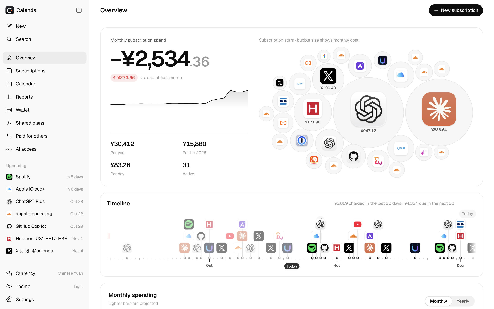
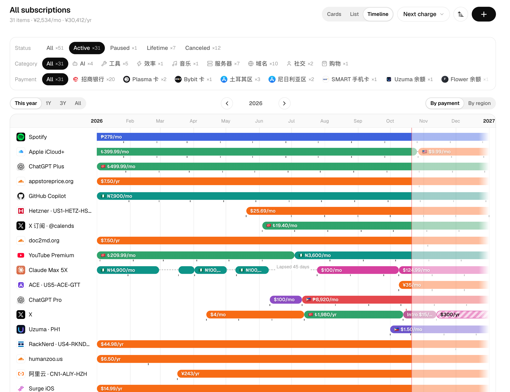

<p align="center">
  
</p>

<h1 align="center">Calends</h1>

<p align="center">
  <b>The settlement day for everything you subscribe to.</b><br />
  A self-hosted, AI-native subscription ledger — multi-currency, shared plans, prepaid balances, reminders, and a built-in MCP server.
</p>

<p align="center">
  <a href="https://calends.date">Website</a> ·
  <a href="https://demo.calends.date">Live demo</a> ·
  <a href="#quick-start">Quick start</a> ·
  <a href="#ai--mcp">AI &amp; MCP</a> ·
  <a href="README.zh-CN.md">简体中文</a>
</p>

<p align="center">
  
</p>
<p align="center">
  
</p>

---

> _Calends_ were the first day of every Roman month — the day accounts were settled and debts called in. It's also where the word _calendar_ comes from.

## Why Calends

Most subscription trackers assume one currency, one card and one person. Real life is messier: an App Store account in Turkey, a family plan you organize and collect money for, a prepaid card that slowly drains, a server billed yearly in euros, a price hike nobody told you about. Calends keeps the whole story — and lets your AI assistant read and update it.

## Features

- **Every subscription, every cycle** — monthly, yearly, every _n_ days/weeks/months, lifetime; trials, intro prices, bonus periods, pauses, "won't renew".
- **Full history** — price changes, plan and region switches, gaps and resumptions; overlapping plans when you start a new one before the old one expires. Each subscription has its own page with total spent, real monthly cost, a per-charge trend against the list price, and every charge grouped by year.
- **Multi-currency done right** — past charges use that day's exchange rate, future ones use today's; switch the whole UI to any base currency or show originals.
- **Wallet & runway** — cards, App Store / Google Play balances, gift cards, prepaid SIMs; see how many charges a balance still covers and how much to top up for a full year.
- **Shared plans & paying for others** — organize family plans, track who paid until when, collect payments; track things you pay on behalf of friends. People are first-class: one place to see what everyone owes you.
- **Reports** — negative MRR, month-over-month changes, cash vs. accrual, prepaid value, savings from cancelling, a "checkup" with actionable insights, and a shareable year-in-review image.
- **Calendar** — month and year views, plus a private ICS feed for Apple/Google Calendar.
- **Reminders everywhere** — email, Telegram, Lark/Feishu, DingTalk, WeCom, Slack, Discord, Bark, ntfy, ServerChan or any webhook.
- **AI-native** — a built-in [MCP](https://modelcontextprotocol.io) server with 20+ tools so Claude, ChatGPT, Codex or Cursor can answer "what renews next week?" or "Netflix went up to $17.99 from today".
- **Private by default** — single-owner app, password + passkeys, device list with remote sign-out. The optional read-only public page masks sensitive data on the server, and you choose which subscriptions appear on it.
- **14 languages** — English, 简体中文, 繁體中文（台灣／香港）, 日本語, 한국어, Español, Français, Deutsch, Português (Brasil), Русский, Türkçe, Bahasa Indonesia, Tiếng Việt.
- **Yours to keep** — full JSON backup/restore, CSV import/export. Runs on Cloudflare's free tier or any machine with Docker.

## Quick start

### Option A — Cloudflare (free tier is plenty)

[](https://deploy.workers.cloudflare.com/?url=https://github.com/imetn/calends)

Or from your machine:

```bash
git clone https://github.com/imetn/calends && cd calends
npm ci
npx wrangler login
npx wrangler secret put SETUP_TOKEN   # any long random string; you'll type it once
npm run deploy                        # builds, creates the D1 database, deploys, migrates
```

Open `https://<your-worker>.workers.dev/admin`, enter the setup token and choose your password. Add a passkey in **Settings → Security** afterwards.

### Option B — Docker

```bash
docker run -d --name calends -p 8787:8787 -v calends-data:/data ghcr.io/imetn/calends:latest
docker logs calends   # prints the one-time setup token on first run
```

Open `http://localhost:8787/admin`. Data lives in the `calends-data` volume as SQLite. See [`docker-compose.yml`](docker-compose.yml) for a compose setup; put it behind Caddy/Nginx/Traefik for HTTPS (passkeys require HTTPS) and set `TRUST_PROXY=1`.

### Option C — let your AI agent do it

Copy this into Claude Code, Codex, Cursor or any coding agent with terminal access:

```text
Deploy Calends (https://github.com/imetn/calends), a self-hosted subscription ledger, for me.
1. Ask me whether to deploy to Cloudflare Workers (free) or Docker on this machine/server.
2. Cloudflare: clone the repo, run `npm ci`, make sure `npx wrangler whoami` works (run `npx wrangler login` if not),
   generate a random SETUP_TOKEN and set it with `npx wrangler secret put SETUP_TOKEN`, then `npm run deploy`.
   If I want a custom domain, add it under "routes" in wrangler.jsonc as a custom_domain before deploying.
3. Docker: run the official image ghcr.io/imetn/calends with a named volume for /data and port 8787,
   then read the setup token from the container logs. Offer to put it behind HTTPS with Caddy.
4. Finally give me the /admin URL and the setup token, and remind me to add a passkey and connect my AI assistant
   on the AI access page (MCP).
```

## AI & MCP

Calends exposes a stateless [MCP](https://modelcontextprotocol.io) endpoint at `/mcp` (Streamable HTTP). Create a token in **AI access** — read-only or read/write — then:

```bash
# Claude Code
claude mcp add --transport http calends https://your-domain/mcp --header "Authorization: Bearer <token>"
# Codex
codex mcp add calends --url https://your-domain/mcp --bearer-token-env-var CALENDS_TOKEN
```

Tools include `get_overview`, `list_subscriptions`, `spending_stats`, `get_trends`, `get_receivables`, `get_insights`, `create_subscription`, `change_price`, `change_plan`, `set_status`, `record_payment` and more. Every write tool supports `dry_run`, and the server can be switched off entirely in Settings.

## Configuration

| Variable                                        | Where           | Purpose                                                                                                                                                                            |
| ----------------------------------------------- | --------------- | ---------------------------------------------------------------------------------------------------------------------------------------------------------------------------------- |
| `DEMO_MODE`                                     | env             | Set to `1` for an anonymous, editable demo that resets daily at 00:00 UTC (Docker triggers around 00:05). See below.                                                               |
| `SETUP_TOKEN`                                   | secret / env    | Required once to set the owner password on a fresh install.                                                                                                                        |
| `BASE_PATH`                                     | build arg + env | Optional subpath without a trailing slash, e.g. `/claude`; defaults to the root. Set the same value at frontend build time and Worker/Docker runtime.                              |
| `DEMO_PROFILE`                                  | env             | `default` (41 subscriptions) or `ai` (61 fictional AI subscriptions); used with `DEMO_MODE=1`.                                                                                     |
| `SITE_URL`                                      | var / env       | Public URL used in reminders and calendar links. Auto-detected if unset.                                                                                                           |
| `EMAIL` binding + `MAIL_FROM`, `MAIL_FROM_NAME` | wrangler        | Optional: email reminders via [Cloudflare Email Sending](https://developers.cloudflare.com/email-routing/email-workers/send-email-workers/). Other channels need no server config. |
| `OLD_HOSTS`                                     | var / env       | Optional: comma-separated old domains after moving to a new one. Pages there 301 to `SITE_URL`; API, MCP and calendar feeds keep working, so existing clients don't break.         |
| `TRUST_PROXY`                                   | env             | Set to `1` behind a reverse proxy so login rate limiting sees the real client IP.                                                                                                  |
| `DATA_DIR`, `PORT`                              | Docker env      | Data directory (default `/data`) and port (default `8787`).                                                                                                                        |

Personal deployment settings (your domain, database id, sender address, your own icons) can live in a git-ignored `local/` folder: `local/wrangler.jsonc` is picked up automatically by the npm scripts and files in `local/public/` override `public/` at build time.

## Public demo

Run the Docker image with `DEMO_MODE=1` and `SITE_URL=https://demo.calends.date` using a dedicated, initially empty data volume. Set `TRUST_PROXY=1` behind a reverse proxy. No setup token or owner password is required; `/` opens `/admin` directly. All visitors share the same editable ledger and display settings. A fresh empty database is seeded automatically with 41 fictional subscriptions; at the UTC midnight scheduled run it resets subscriptions, wallet, people, settings, preferences, chats and credentials. Exchange rates and migration records are retained.

Password, passkeys, device management, notification channel saving/testing and delivery, MCP, private ICS links and public-page switching are unavailable. The demo also disables backup restore and CSV import entirely to prevent bulk uploads; exports remain available. These restrictions are enforced by the Worker with localized errors as well as explained in the UI. Normal installations without `DEMO_MODE=1` keep their existing behavior.

The assistant offers local scripted conversations in both demo profiles: receipt drafts, current-month charges, recent price increases, and (AI profile) Claude plan reviews. It makes no AI API requests and keeps chats only in the browser. Confirmed receipt drafts are saved to the shared demo ledger and reset with it. A self-hosted instance uses your own API key for real AI.

For an AI account-management demo under `/claude/` (the reverse proxy must preserve the prefix):

```bash
docker build --build-arg BASE_PATH=/claude -t calends-ai .
docker run -d --name calends-ai -p 8788:8787 -v calends-ai-data:/data \
  -e BASE_PATH=/claude -e DEMO_MODE=1 -e DEMO_PROFILE=ai \
  -e SITE_URL=https://demo.calends.date -e TRUST_PROXY=1 calends-ai
```

Open `https://demo.calends.date/claude/admin`. Use a separate initially empty volume from the default demo. `SITE_URL` may include `/claude`; it is appended only once. Unprefixed health-check API paths remain available. The AI profile has 40 Claude accounts (13 monthly Pro, 3 annual Pro, 14 Max 5x, 10 Max 20x), 16 ChatGPT accounts (7 Plus, 4 Pro 5x, 3 Pro 10x, 2 Pro 50x), and five other AI tools. All identities, prices and sharing arrangements are fictional examples; ChatGPT plan names in this profile are demo labels. Generate a backup with `node --experimental-strip-types scripts/demo.ts --profile ai`.

## Development

```bash
npm ci
npm run db:migrate:local
echo "DEV_BYPASS_AUTH=1" > .dev.vars   # local only: skip login
npm run dev                            # Vite on :5173 + Worker on :8787
```

| Command                                                 |                                                |
| ------------------------------------------------------- | ---------------------------------------------- |
| `npm test`                                              | Unit tests (billing, phases, metrics, masking) |
| `npm run typecheck` / `npm run lint` / `npm run format` | TypeScript, oxlint, Prettier                   |
| `npm run i18n:check`                                    | Every locale has every key                     |
| `npm run build`                                         | Production build                               |

Stack: React 19 with the React Compiler, Vite, react-aria-components for dialogs, menus and controls (admin), shadcn/ui (public page), Cloudflare Workers + D1 (SQLite), and shared TypeScript domain logic in `shared/`.

```
src/        admin app and public page
shared/     billing, phases, metrics, fx, masking, i18n — used by both browser and worker
worker/     API, auth (password + passkeys), MCP, reminders and channels, backup, ICS
migrations/ D1 / SQLite schema
docker/     self-hosting image entrypoint
```

## Translations

Strings live in `shared/locales/<locale>/<namespace>.json`. English and Simplified Chinese are the source languages. To improve or add a language, edit or copy a locale folder and run `npm run i18n:check`. See [CONTRIBUTING.md](CONTRIBUTING.md).

## License

[MIT](LICENSE)
