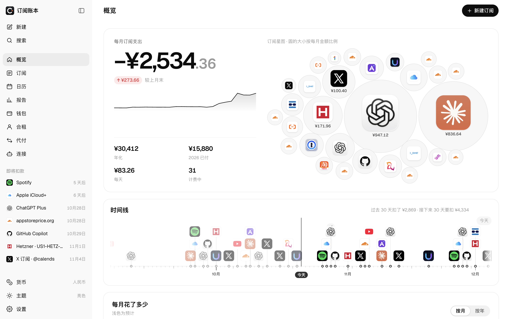
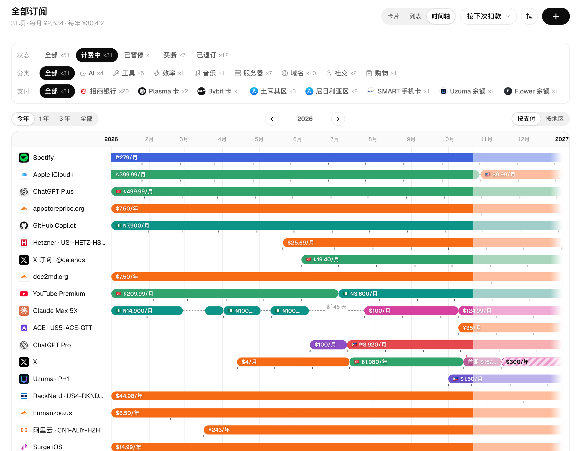

<p align="center">
  
</p>

<h1 align="center">Calends · 订阅账本</h1>

<p align="center">
  <b>给你订阅的一切，一个结账日。</b><br />
  可自托管、原生支持 AI 的订阅账本：多币种、合租分摊、余额续航、多渠道提醒，内置 MCP 服务器。
</p>

<p align="center">
  <a href="https://calends.date">官网</a> ·
  <a href="https://demo.calends.date">在线演示</a> ·
  <a href="#快速开始">快速开始</a> ·
  <a href="#ai-与-mcp">AI 与 MCP</a> ·
  <a href="README.md">English</a>
</p>

<p align="center">
  
</p>
<p align="center">
  
</p>

---

> Calends 是罗马历每个月的第一天，那天结清账目、收回欠款；英文的 calendar（日历）就由它而来。

## 为什么做它

大多数订阅记账工具默认你只有一种货币、一张卡、一个人。现实要复杂得多：土耳其区的 App Store、你当车主向成员收钱的家庭套餐、慢慢花完的预付卡、按年用欧元付的服务器、悄悄涨了价的会员。Calends 记下完整的来龙去脉，还能让你的 AI 助手直接查询和修改。

## 功能

- **各种周期**：月付、年付、每 N 天/周/月、买断；试用、首期优惠、赠送时长、暂停、到期不续。
- **完整历程**：调价、换套餐、换区、断更与续订；提前开通新区、旧区尚未到期时，两段可以重叠。每个订阅都有自己的详情页：累计花了多少、实际每月多少、每笔扣款与标价的走势，以及按年分组的扣款记录。
- **多币种**：过去的扣款按当天汇率折算，未来按今天汇率；可随时切换本位币或显示原币。
- **钱包与余额续航**：银行卡、App Store / Google Play 余额、礼品卡、手机卡；看余额还能扣几期、撑满一年还要充多少。
- **合租与代付**：车主记录成员付到哪天、一键收款；也能记替朋友付的钱。「人」是独立的数据，一眼看清每个人欠你多少。
- **报告**：负 MRR、月度变动瀑布、现金与权责对比、预付价值、退订省下的钱、可执行的「体检」建议，以及可分享的年度回顾图。
- **日历**：月视图、年视图，以及可订阅到苹果 / 谷歌日历的私密 ICS 链接。
- **多渠道提醒**：邮件、Telegram、飞书、钉钉、企业微信、Slack、Discord、Bark、ntfy、Server酱、自定义 Webhook。
- **原生 AI**：内置 [MCP](https://modelcontextprotocol.io) 服务器，20 多个工具，Claude、ChatGPT、Codex、Cursor 都能回答「下周有什么要续费」，或者执行「Netflix 从今天起涨到 17.99 美元」。
- **默认私密**：单用户；密码加 Passkey，登录设备可远程下线。只读公开页可选开启，敏感信息在服务端脱敏，展示哪些订阅由你挑选。
- **14 种语言**：English、简体中文、繁體中文（台灣／香港）、日本語、한국어、Español、Français、Deutsch、Português (Brasil)、Русский、Türkçe、Bahasa Indonesia、Tiếng Việt。
- **数据归你**：完整 JSON 备份与恢复、CSV 导入导出。Cloudflare 免费额度就够用，也能用 Docker 跑在任何机器上。

## 快速开始

### 方式一：Cloudflare（免费额度足够）

[](https://deploy.workers.cloudflare.com/?url=https://github.com/imetn/calends)

或者在本机执行：

```bash
git clone https://github.com/imetn/calends && cd calends
npm ci
npx wrangler login
npx wrangler secret put SETUP_TOKEN   # 填一串足够长的随机字符串，只用一次
npm run deploy                        # 构建、创建 D1 数据库、部署、迁移
```

打开 `https://<你的 worker>.workers.dev/admin`，输入初始化令牌并设置密码。之后建议在「设置 → 安全」里绑定 Passkey。

### 方式二：Docker

```bash
docker run -d --name calends -p 8787:8787 -v calends-data:/data ghcr.io/imetn/calends:latest
docker logs calends   # 首次启动会打印一次性的初始化令牌
```

打开 `http://localhost:8787/admin`。数据以 SQLite 文件保存在 `calends-data` 卷里。compose 配置见 [`docker-compose.yml`](docker-compose.yml)。公网使用请放在 Caddy / Nginx / Traefik 等反向代理后面启用 HTTPS（Passkey 需要 HTTPS），并设置 `TRUST_PROXY=1`。

### 方式三：交给你的 AI 助手

把下面这段话发给 Claude Code、Codex、Cursor 等能操作终端的 AI：

```text
帮我部署 Calends（https://github.com/imetn/calends），一个可自托管的订阅账本。
1. 先问我部署到 Cloudflare Workers（免费）还是这台机器/服务器上的 Docker。
2. Cloudflare：克隆仓库，执行 npm ci，确认 `npx wrangler whoami` 正常（不行就 `npx wrangler login`），
   生成一个随机的 SETUP_TOKEN 并用 `npx wrangler secret put SETUP_TOKEN` 设置，然后 `npm run deploy`。
   如果我要自定义域名，部署前在 wrangler.jsonc 的 routes 里以 custom_domain 加上。
3. Docker：运行官方镜像 ghcr.io/imetn/calends，给 /data 挂一个命名卷，开放 8787 端口，
   再从容器日志里读出初始化令牌；顺便问我要不要用 Caddy 配 HTTPS。
4. 最后把 /admin 地址和初始化令牌告诉我，并提醒我绑定 Passkey，以及在后台「连接」页接入我的 AI 助手。
```

## AI 与 MCP

Calends 在 `/mcp` 提供无状态的 [MCP](https://modelcontextprotocol.io) 接口（Streamable HTTP）。在后台「连接」页生成令牌（只读或读写），然后：

```bash
# Claude Code
claude mcp add --transport http calends https://你的域名/mcp --header "Authorization: Bearer <令牌>"
# Codex
codex mcp add calends --url https://你的域名/mcp --bearer-token-env-var CALENDS_TOKEN
```

工具包括 `get_overview`、`list_subscriptions`、`spending_stats`、`get_trends`、`get_receivables`、`get_insights`、`create_subscription`、`change_price`、`change_plan`、`set_status`、`record_payment` 等。所有写操作都支持 `dry_run` 预览，也可以在设置里一键关闭 AI 连接。

## 配置

| 变量                                         | 位置              | 作用                                                                                                                                                          |
| -------------------------------------------- | ----------------- | ------------------------------------------------------------------------------------------------------------------------------------------------------------- |
| `SETUP_TOKEN`                                | secret / 环境变量 | 新部署首次设置密码时需要。                                                                                                                                    |
| `SITE_URL`                                   | 变量 / 环境变量   | 提醒和日历里使用的站点地址；不设时自动识别。                                                                                                                  |
| `EMAIL` 绑定 + `MAIL_FROM`、`MAIL_FROM_NAME` | wrangler          | 可选：通过 [Cloudflare Email Sending](https://developers.cloudflare.com/email-routing/email-workers/send-email-workers/) 发邮件提醒；其他渠道无需服务端配置。 |
| `TRUST_PROXY`                                | 环境变量          | 在反向代理后面时设为 `1`，登录限速才能拿到真实访客 IP。                                                                                                       |
| `DATA_DIR`、`PORT`                           | Docker 环境变量   | 数据目录（默认 `/data`）和端口（默认 `8787`）。                                                                                                               |

个人部署的配置（自己的域名、数据库 ID、发件地址、头像等）可以放在被 git 忽略的 `local/` 目录：npm 脚本会自动使用 `local/wrangler.jsonc`，构建时 `local/public/` 里的文件会覆盖 `public/` 里的同名文件。

## 公开演示站

Docker 设置 `DEMO_MODE=1`、`SITE_URL=https://demo.calends.date`，使用独立的初始空数据卷；反向代理后设置 `TRUST_PROXY=1`。无需初始化令牌或密码，访问 `/` 直接进入 `/admin`。所有访客共用可编辑账本和显示设置。空库自动生成 41 条虚构订阅；每日 UTC 零点的定时任务复原账本、支付方式、人员、设置、偏好、聊天记录和凭据（Docker 约 00:05 执行），保留汇率与迁移记录。

演示模式禁用密码、Passkey、设备管理、通知渠道保存与测试、提醒实际发送、MCP、AI 助手、ICS 链接和公开页开关。备份恢复与 CSV 导入选择完全禁用，防止批量灌入；仍可导出。界面说明「演示站不可用」，服务端也返回本地化错误。不设置 `DEMO_MODE=1` 的正常自托管行为不变。

## 本地开发

```bash
npm ci
npm run db:migrate:local
echo "DEV_BYPASS_AUTH=1" > .dev.vars   # 仅本地：跳过登录
npm run dev                            # Vite :5173 + Worker :8787
```

技术栈：后台用 React 19（开启 React Compiler）+ Vite，弹窗、下拉、开关等交互组件基于 react-aria-components；公开页用 shadcn/ui；服务端是 Cloudflare Workers + D1（SQLite）；计费、汇率、脱敏等领域逻辑放在 `shared/`，浏览器和 Worker 共用。

`npm test` 单元测试，`npm run typecheck` / `lint` / `format` 类型检查、代码检查与格式化，`npm run i18n:check` 检查各语言文案是否齐全。贡献指南见 [CONTRIBUTING.md](CONTRIBUTING.md)。

## 许可

[MIT](LICENSE)
